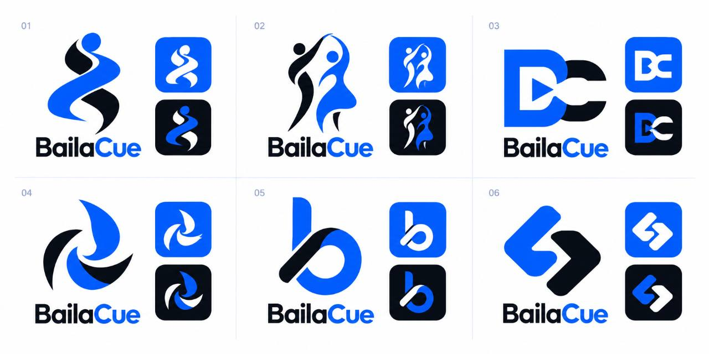

# BailaCue · new requirements · round 2

Status: all six owner-approved issues are implemented in published 0.2.21/build26. All 14 recorded native checks pass. Live-provider and iOS runtime limits are recorded in VERIFICATION.md.

This is a new list of feedback on Android preview 0.2.17/build22. It is separate
from the earlier 22-issue requirements and uses a new `R2` numbering sequence.
The previous requirements document remains unchanged.

## R2-01 · Make YouTube video titles compact

**Problem:** The supplied screenshot shows “How To DANCE Bachata During
Quarantine (4 Beginner Basic Steps)” as an oversized, five-line heading, taking
space away from the video.

**Requirement:** Use a smaller, compact video-title treatment on the YouTube
playback page. Keep Back easy to reach and give the video more screen space.

**Acceptance:**

- At the default text size, long titles use at most two lines in the compact
  header, with an obvious way to read the complete title.
- Preserve the complete original title in metadata; shortening the display must
  not rename or discard it.
- Support system text scaling and screen-reader access to the complete title.
  Title and Back must not overlap or clip on narrow screens or with large text.
- Check the supplied long-title example at 320, 360 and 412px widths.

## R2-02 · Let users resize the YouTube video area

**Problem:** The YouTube playback page has no visible way to make its video area
larger or smaller.

**Requirement:** Add a discoverable resize control to the YouTube player, with
drag-to-resize and an accessible alternative for increasing/decreasing its size.

**Acceptance:**

- Users can enlarge or reduce the video area without leaving the playback page.
- Resizing preserves the picture's aspect ratio and the official YouTube player's
  controls, captions, attribution and supported minimum dimensions.
- Playback position, play/pause state and selected speed survive resizing;
  resizing must not reload the video or restart it from the beginning.
- The resize gesture and ordinary page scrolling do not interfere with each
  other or with the video's seek controls.
- Essential playback actions remain reachable at the largest and smallest sizes;
  screen readers can operate the size adjustment.

## R2-03 · Add discoverable YouTube full-screen playback

**Problem:** The screenshot has no visible full-screen action alongside the
YouTube playback controls.

**Requirement:** Add an explicit **Full screen** action that opens an enlarged
YouTube playback view, with an obvious way to return. Use the supported official
player; opening the external YouTube app is a separate fallback.

**Acceptance:**

- Full screen is visible and usable without hunting through settings or extra tools.
- Entering and exiting preserves the current video, position, play/pause state
  and supported speed; it must not duplicate playback or reset the lesson.
- Controls and captions remain usable in portrait and landscape, with safe areas
  respected. Provide a visible exit action; Android Back exits full screen first.
- Backgrounding and resuming retain BailaCue's existing pause rules.
- Verify actual embedded playback on Android and iOS separately. If a platform
  restricts full-screen playback, explain that state and offer Open in YouTube;
  do not present an ineffective full-screen button as working.

## R2-04 · Replace the app icon using the newly selected concept

**Owner feedback:** The current icon does not look good. Use the **fifth icon/photo
in the second icon-concept screenshot**, now identified by the supplied board as
**concept05: the lowercase “b” mark in the bottom-middle panel**, and add a
**triangular play button in the middle**.

**Requirement:** Use concept05's blue loop and upright with its black diagonal
stroke as the base of the next app icon. Add a clearly visible, right-facing play
triangle centered inside the loop of the “b”. This is the updated icon selection
for round 2; the earlier concept03 selection remains historical.

**Background requirement:** The owner requests a **transparent background**.
The revised symbol artwork and in-app icon must have genuine transparency, with
no white, blue or black rectangular tile baked around the mark. The blue/black
strokes and central play triangle remain part of the symbol itself.

**Confirmed reference:** The owner supplied `1000072660.jpg`. The unchanged board
is saved at [round-2-selected-concept-05-board.jpg](brand/round-2-selected-concept-05-board.jpg).
Use the panel numbered **05**, not the adjacent designs or the previous BC mark.
The board is reference artwork. The revised editable master and 70 exports are
committed under assets/brand and listed in its manifest.

**Acceptance:**

- The base design matches concept05 on the confirmed board, with a comparison preview
  showing the reference and the revised icon.
- The play triangle sits in the middle, has clear contrast, and preserves the
  distinguishing features of the selected base design.
- Deliver transparent SVG and PNG artwork with clean alpha edges. In-app use
  renders the symbol directly over the current screen background without an
  added square tile; verify it on both light and dark surfaces.
- Use transparency for the Android adaptive foreground. Keep any OS-required
  launcher background or flattened iOS export separate from the transparent
  master. Platform launchers may apply a background/mask; do not promise fully
  transparent launcher tiles where the OS requires a background.
- The symbol and triangle remain recognizable at small launcher sizes and under
  Android/iOS icon masks; check light, dark and supported themed presentation.
- During implementation, update affected launcher/adaptive/monochrome/iOS and
  in-app icon exports consistently. Keep the reference, editable master, exports
  and updated asset manifest in Git, following the existing brand asset contract.
- This request changes the icon design; it does not request another app rename
  or a change to the app's blue/black colour theme.

## R2-05 · Make YouTube playlists addable to the Library

**Owner report:** YouTube playlists currently appear impossible to add. The owner
requests a working playlist-add flow and subsequently authorized implementation of this round.

**Requirement:** Let users paste a supported public YouTube playlist link, review
its contents, choose all or selected available videos, and explicitly add the
playlist and selected videos to their Library. The optional beginner suggestion
must use the same working flow.

**Acceptance:**

- **Add selected videos** is discoverable after playlist details load, with the
  selected count and a clear explanation when adding is not yet available.
- Loading playlist contents and saving selections must not require the preview
  video to start playing. Playback errors must not block an otherwise valid import.
- Clearly explain any required API configuration, invalid/restricted key, quota
  limit, unavailable playlist, network failure or empty result, with a useful
  setup/retry action. Do not leave users indefinitely waiting for hidden controls.
- The keyless path must state what it can actually import. Do not describe setup
  as optional while silently making it necessary to complete that same journey.
- After Add, show confirmed completion and an obvious **Open Library** action.
  The named playlist and selected videos appear in the Library and remain after
  reopening the app. A preview or an empty placeholder is not a successful import.
- Preserve playlist order, personal ratings/labels/notes and existing memberships.
  Repeated imports and overlapping playlists must not duplicate videos.
- Refresh discovers additions without erasing existing personal metadata when
  requests fail or the returned list is incomplete.
- Verify the owner's Bachata Tutorials playlist and another public playlist on
  an actual Android build; record iOS verification separately. Include missing/
  invalid configuration, preview playback failure, retry, duplicate import and
  persistence cases. Distinguish mocked checks from live import evidence.
- YouTube entries remain online links; adding them does not download video files.

## R2-06 · Center chip groups across the page

**Owner clarification:** Center the chips as a group across the screen, including
wrapped rows. This request concerns group placement, rather than changing the text
alignment within each chip.

**Requirement:** Center each chip row within the available screen/card width,
including the shorter last row when a group wraps. Apply this consistently to
playback speeds, ratings, dance/source/label filters, Practice and Settings choices,
import destinations, account modes and playlist-selection actions.

**Acceptance:** Equal free space appears to the left and right of every wrapped
row. Chips keep natural widths, readable labels, existing touch targets and selection
behavior. Check narrow phone layouts and both themes. Page headings, form fields,
playlist content and navigation retain their own alignment.

## Implementation order and evidence

1. R2-05: unblock playlist import and prove that added videos reach the Library.
2. R2-01: compact title and header layout.
3. R2-02: resize behavior and accessible controls.
4. R2-03: full-screen lifecycle and device verification.
5. R2-04: match the selected artwork, add the centered play triangle, and update
   affected icon assets. This design task can proceed independently of the player work.

The user's screenshot `1000072658.png` in the conversation is the visual reference;
the personal screenshot is not published in Git. Capture before/after evidence
using a public lesson or synthetic test content. Browser layout checks complement
actual Android/iOS player checks; record untested platforms explicitly.

Implementation scope is this round-2 list. Existing libraries, originals, source choices and optional numbering are preserved. See VERIFICATION.md for the current build and the distinction between automated, native and live-provider evidence.

Build23/tag v0.2.18-preview.23 was withheld before publication for the final transparent lock-screen mark and landscape full-screen-action placement corrections.

Build24 was withheld before publication after the launcher-mask check found clipping in the adaptive foreground. Build25 pads only the adaptive layers to preserve the complete symbol under Android masks.

Current evidence:190 unit/database tests,14 browser journeys, centered-row geometry, Android native acceptance, verified public APK identity and fresh iOS simulator compilation. See [verification](VERIFICATION.md) for actual scope and remaining manual acceptance.

## Implementation and remaining acceptance · build26

| Issue         | Delivered / evidence                                                                                                                                     | Remaining acceptance                                                                                          |
| ------------- | -------------------------------------------------------------------------------------------------------------------------------------------------------- | ------------------------------------------------------------------------------------------------------------- |
| R2-01         | Compact two-line title, expand action and complete accessible title; browser widths320/360/412                                                           | Full native large-font/screen-reader review                                                                   |
| R2-02 / R2-03 | Resize grip, accessible adjustments, full screen and Android Back; controlled browser checks preserve player identity, position, speed and playing state | Live embedded playback on Android and iPhone; the live Android playlist timed out before a playable import    |
| R2-04         | Approved b/play SVG and 70 exports; transparent in-app artwork; all 10 compiled Android adaptive/themed layers fit the 66dp safe zone                    | Broader physical launcher/device review                                                                       |
| R2-05         | Visible Add, cue-before-play, durable save/retry/Open Library, API pagination and partial-refresh preservation; domain and browser regressions pass      | Live public playlist import timed out without an API key; second playlist and iPhone import remain unverified |
| R2-06         | Whole chip groups and shorter wrapped rows center; 34 groups measured at 320/412px with 0px maximum error; light/dark screenshots                        | Full native font-scale/accessibility review                                                                   |

All 14 native editing/Practice regression checks pass. They do not claim successful
live YouTube import; see [the report and exact limits](VERIFICATION.md).
