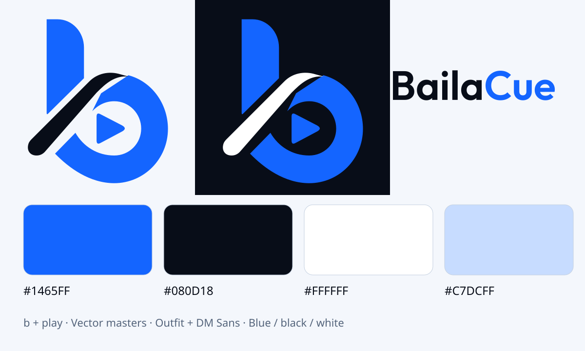

# BailaCue · b + play · concept05

The owner selected concept **05**, the lowercase b in the bottom-middle of
[the supplied board](round-2-selected-concept-05-board.jpg), and approved a centered
right-facing play triangle with transparent artwork. The approved image-generated
preview is `assets/brand/b-play-approved-preview.png`. The active SVG master is a
clean geometric refinement of that preview: four filled paths, no embedded raster,
background tile or stray alpha pixels. The previous BC master is archived separately.

In-app symbols have real transparency and no tile. Dark surfaces use a blue/white
variant so the diagonal stays visible. Android uses a transparent adaptive foreground;
the OS applies the configured pale background/mask. iOS/app-store artwork is a separate
opaque export. App name and blue/black UI colours remain unchanged.

Brand blue `#1465FF`, black `#080D18`, white and pale blue `#C7DCFF`. UI actions use
`#145BE0`/white in light mode and `#8AB6FF`/black in dark mode for readable contrast.
Outfit SemiBold is the display face; DM Sans is the interface face.

| Asset                        | Path / specification                                                                                           |
| ---------------------------- | -------------------------------------------------------------------------------------------------------------- |
| Vector symbol master         | `assets/brand/symbol-master.svg` — SVG paths, no raster                                                        |
| Outlined wordmark            | `assets/brand/wordmark-master.svg` — Outfit glyph paths                                                        |
| Original artwork             | `assets/brand/b-play-approved-preview.png`; previous sources retained for history                                                      |
| App and iOS artwork          | `assets/icon.{png,svg}`, `assets/brand/ios-app-store.png` — opaque1024                                         |
| Adaptive foreground          | `assets/adaptive-icon.png` — transparent blue/black symbol, pale OS-configured background                              |
| Android themed icon          | `assets/adaptive-monochrome.png` — single-colour symbol with alpha                                             |
| Symbols                      | `assets/brand/symbol-{color,color-dark,blue,black,white}-transparent.{svg,png}`                                                 |
| Logo family                  | `assets/brand/logo-{horizontal,stacked}-{light,dark,mono-white,mono-black}[-transparent].{svg,png}`            |
| Splash                       | `assets/splash-icon.png` — blue/white symbol with alpha, black configured background                                |
| Favicons / PWA / Apple touch | `assets/favicon.png`, `assets/brand/favicon-{16,32}.png`, `android-icon-{192,512}.png`, `apple-touch-icon.png` |
| Badges                       | `docs/brand/badge-{salsa,bachata,practice,youtube}.{svg,png}`                                                  |
| Social / feature image       | `assets/brand/social-1200x630.{svg,png}`, `play-feature-1024x500.{svg,png}`                                    |
| Manifest                     | `assets/brand/manifest.json` —70 exports, sizes, alpha, SHA256                                                 |

Paths are relative to the repository. Historical status badges and original icon
sources remain for provenance; they are not active learning-status UI.

Run `npm run brand` to reproduce exports from the committed SVG masters. The SVG
logos have outlined text and do not depend on fonts being installed. Social
straplines and badge text remain editable SVG text with a sans-serif fallback.
To recreate the outlined wordmark, install Python `fonttools` and run
`python3 scripts/outline-wordmark.py` against the bundled OFL Outfit font.
The refined symbol master has explicit blue and ink paths; monochrome variants are
palette substitutions of those same paths. Normal regeneration needs only `sharp`
and never calls an image service. The approved raster preview is retained as
provenance, not used as the runtime icon or as an SVG raster container.

Store artwork is prepared in Git; publishing store listings or taking store-specific
marketing screenshots is a separate distribution step. No app-store submission is
implied by these exports.

Android adaptive foregrounds use a separate padded placement (600px inside a1024px transparent canvas), preserving the whole symbol inside the central66dp safe zone of the108dp layer. The transparent master/in-app artwork is unchanged. See [Android adaptive icon guidance](https://developer.android.com/develop/ui/views/launch/icon_design_adaptive).
